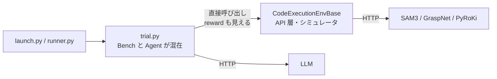
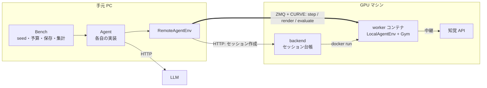

# CaP-X Agent 分離とリモート実行 — 計画と進捗

> 時点: 2026-10-15（`feat/libero-remote-env` ブランチ）
> 設計の詳細（通信・制限・設定・指標）は [`docs/RemoteDevelopment.md`](docs/RemoteDevelopment.md)。
> ここには、何のために何をどの順で作り、どこまで済んだかをまとめる。

## 1. 目的

- **Agent を差し替えやすくする。** 各自が `trial.py` を書き換えずに、自分の Agent（LLM の呼び方・プロンプト・multi-turn の戦略）を差し込める。
- **依存を一方向にする。** Gym（シミュレータと採点）と Bench（評価・集計）は Agent を知らない。
- **比較できる。** Agent が違っても、同じタスク・同じ予算・同じ指標で評価する。報酬と成功判定は Bench だけが読み、Agent には見せない。
- **遠隔で回せる。** シミュレーションは GPU マシン、Agent は手元 PC。手元にはシミュレータも GPU も要らない。

## 2. 変更前と変更後

### 変更前

評価を回す `capx/envs/trial.py` の 1 関数（`_run_single_trial`）に、Bench の仕事（reset・seed・保存・集計・timeout）と Agent の仕事（LLM 呼び出し・画像差分・multi-turn の判断）が同居し、Gym を Python オブジェクトとして直接呼んでいた。Agent からも `reward` / `task_completed` が見え、Agent だけを差し替えることも、Gym を別マシンに置くこともできなかった。

### 変更後

Bench と Agent を分け、間に `AgentEnv`（`step(code)` / `render()` / `close()` だけ）を置いた。実装は 2 つあり、Agent からは区別できない。

- `LocalAgentEnv`: 同じプロセスの `CodeExecutionEnvBase` を包む（ローカル実行）
- `RemoteAgentEnv`: GPU マシンの worker コンテナに ZMQ で繋ぐ（リモート実行）

- 切る場所は Gym の外側（`CodeExecutionEnvBase` の中身は作り替えない）。送るのはコード文字列、受け取るのは stdout / stderr・画像・動画だけなので通信が小さい。
- 採点（`evaluate`）は worker が計算した値を Bench が読む。クライアントから値は受け取らない。
- LLM は手元から直接呼ぶ。API キーは GPU マシンに置かない。

## 3. ディレクトリ

| 場所 | 持ち主 | 中身 |
| --- | --- | --- |
| `capx/agent_api/` | 共通 | 契約の型（`TaskSpec` / `Budget` / `StepResult` / `AgentResult` / `AgentEnv` / `BaseAgent`）。標準ライブラリだけで書く。`components/` に Agent 共通の部品（コード抽出・画像差分） |
| `capx/bench/` | Bench | 1 trial の実行（reset → `agent.run` → evaluate → 保存）、成果物、結果のスキーマ、エラーの分類、`doctor` |
| `capx/baselines/` | Agent | 組み込みの `CaPAgent0`（旧 `trial.py` の Agent 部分）と `OracleAgent` |
| `capx/local_env.py` | Gym の窓口 | `LocalAgentEnv`。予算の強制もここ |
| `capx/remote_env/` | 遠隔 | `client.py`（`RemoteAgentEnv`）、`protocol.py`、`server/`（backend）、`worker/`（worker と生成コード用の子プロセス） |
| `docker/worker/` | 遠隔 | worker image（`Dockerfile` = robosuite、`Dockerfile.libero`） |
| `docker/backend/` | 遠隔 | 知覚 API への中継（`docker-compose.yml`） |
| `local/` | 利用者 | ローカル実行の入口 `local/trial.py` |
| `remote/` | 利用者 | リモート実行の入口。ルートとは別の uv プロジェクトで、シミュレータの依存を引かない（`trial.py` / `doctor.py` / `agents/` / `README.md`） |

## 4. フェーズと状態

| Phase | 内容 | 状態 |
| --- | --- | --- |
| 0A | 信頼境界と契約（型・スキーマ・seed 規約）の明文化 | 済み。ネットワーク隔離の実測（0A-4）は見送り |
| 0B | 既存テストで前後比較の基準を取る | 済み。専用の golden 比較は作らない（§5） |
| 1 | 型と `LocalAgentEnv`、`expose_env`、時計 2 本 | 済み |
| 2 | `CaPAgent0` / `OracleAgent` の抽出、Bench 側の整理 | 済み |
| 3 / 3.5 | YAML・CLI の分割（`bench:` / `agent:`）、`local/`、依存の extras 分離、`remote/` の独立 | 済み |
| 4A | worker コンテナ（プロセス分離・録画バッファ・サーバ側採点） | 済み |
| 4B | backend（セッション・CURVE・同時数の上限・回収） | 済み。認証は任意（既定オフ） |
| 4C | `RemoteAgentEnv`・`remote/`・`doctor`・エラー分類 | 済み |
| 4D | 実行中のフレームのストリーミング | 済み（手元のテストのみ） |
| 5 | 指標（`task_completion_rate` を主指標に）と成果物 | 済み |
| 6 | LIBERO 対応 | 済み（このブランチ。§6） |
| 7 | BEHAVIOR 対応 | 未着手 |
| — | Snapshot / Resume / Fork（[`docs/Snapshot.md`](docs/Snapshot.md)） | 実装済み。手元（Docker なし）で robosuite / LIBERO の E2E を確認。GPU マシン・MinIO での確認は未 |
| — | 旧経路の整理 | Phase 6・7 の後に行う（§7） |

Phase 0〜5 は PR #4 で `main` にマージ済み。Phase 6 は `feat/libero-remote-env` から `main` への PR で出す。

### 実機（GPU マシン）で確認したこと

- robosuite（cube_stack）と LIBERO を、手元 PC から `remote/trial.py` で最後まで実行できる（組み込みの `CaPAgent0` と `remote/agents/example_agent.py`）
- 結果（`result.json`・各ステップのコード・LLM の入出力・動画・画像）が手元の `remote/outputs/` に返る
- worker が落ちたとき、手元が 45 秒で気づき、新しいセッションでやり直す
- worker は非 root・読み取り専用で動き、生成コードは別プロセスで実行される

## 5. 主な判断と理由

**ループは Agent が持つ。** Agent は `run(env, task, budget)` を 1 つ実装する。1 ステップ関数（`act(obs) -> code`）にすると、multi-turn の判断・ensemble・実行前の観察など Agent ごとの形を縛るため。回数と時間の上限は `AgentEnv` 側で強制する。

**報酬と成功判定は Agent に見せない。** `StepResult` には `reward` / `task_completed` / 生の観測を入れない。採点は Agent の実行が終わった時点の状態で 1 回だけ行う。

**Agent のクラス名は `Agent` に固定する。** ファイルに `class Agent(BaseAgent)` を書く。1 ファイル 1 Agent では名前を自由にする利点が小さく、親クラスで共通処理をまとめると候補が複数になって選ぶ規則が別に要るため。`run` を書き忘れると接続前にエラーになる。

**前後比較は既存のテストで行う（1 バイト一致の golden は作らない）。** このベンチは同じ条件でも結果が揺れる（reward が連続値で、即座に例外で終わるコードでも揺れる）。oracle の reward と、幅を持たせた基準のスモーク（`scripts/regression_test.sh quick`）で前後を見る。

**通信は HTTP（制御）と ZMQ（データ）に分ける。** backend はセッションを作って worker を起動するだけで、`step` の経路には入らない。手元は worker に ZMQ（CURVE で暗号化・鍵はセッションごと）で直接繋ぐ。backend を挟むと構造が複雑になり、帯域も backend に集まるため。

**worker は 1 セッション 1 コンテナ。** 非 root・読み取り専用・ネットワークは `--internal`（知覚 API へは中継だけ）。生成コードは worker 内の別プロセスで実行し、ロボットの API は RPC で渡す。運用は非敵対的なワークショップを前提とし、守る範囲は設計書 §5 に書いた。

**録画フレームは JPEG（品質 90）で持ち、上限は 400MB。** 生の画像で持つと LIBERO（800×512）でメモリ上限を超えたため。超えたら古いフレームを間引き、試行の最後まで動画を残す。

**LIBERO の worker のメモリ不足は、点群の距離計算を区切ることで解決した。** LIBERO の API が、2 台のカメラの物体の点群の全ての組の距離を一度に計算していた（1 組 64 バイト、1.2 万点 × 1.2 万点で約 8.7GB）。同じ式を区切って計算し、結果は元と変わらない（`capx/utils/pairwise.py`）。修正前は 4 回の実行で強制終了が 5 回、修正後は 0 回。起動直後に 3.4GB 前後を使う回があり余裕が小さいので、LIBERO の worker の上限は 5GB にした（robosuite は 4GB）。backend は上限の合計で受け付けを制限する（既定 100GB）。

**リモートの結果は `remote/outputs/<モデル名>/<タスク名>/<日時>/` に保存する。** ローカル実行の `outputs/`（リポジトリ直下）と分け、実行ごとに日時のフォルダを作って前の結果と混ざらないようにした。`--no-save` で保存しない。

## 6. Phase 6（LIBERO）で行ったこと

- 標準の 5 suite（`libero_spatial` / `libero_object` / `libero_goal` / `libero_10` / `libero_90`）の全 130 タスクを `<suite>_<番号>`（例: `libero_object_3`）で選べる。設定は 1 本で、suite 名と番号は backend の許可リストから上書きする（クライアントからは受けない）
- LIBERO 用の worker image（`docker/worker/Dockerfile.libero`）
- ゴール文 `{libero_environment_goal}` を reset で実際の文に置き換える
- 物体が SAM3 で見つからないときに使う Molmo2 を、他の知覚 API と同じく中継経由で呼ぶ
- 実機で見つかった問題の修正:
  - 非 root の worker が、root が作った URDF のキャッシュを git で読めなかった
  - `task_completed` が numpy の真偽値で、`result.json` に書けなかった
  - LIBERO の IK（コンテナ内の JAX）がホストのコア数ぶんスレッドを作り、pids の上限を超えた
  - worker が落ちても、手元が送信の成否しか見ておらず気づかなかった
  - メモリ不足（§5）

## 7. 既知の問題と残りの作業

- **seed が robosuite の初期配置まで届いていない。** `robosuite_cubes.py` は seed から capx 側の乱数を作るだけで、`robosuite_env.reset()` には渡していない。Agent 同士のスコアを厳密に比べるには対応が要る
- **旧経路が残っている。** 新しい Bench（`capx/bench`、`local/trial.py`、`remote/trial.py`）は使わないが、次は残っている。LIBERO・BEHAVIOR の対応が終わってから整理する
  - `capx/envs/trial.py`（`_patch_libero_goal`、`evolve_skill_library` の呼び出しを含む）
  - `capx/envs/launch.py` / `capx/envs/runner.py`（API サーバの検証を `capx/bench/` へ移す）
  - プロンプトの組み立て（`capx/utils/launch_utils.py` → `capx/baselines/prompts.py`）
  - `TrialSummary` / `_print_and_save_summary`（→ `capx/bench/`）
  - `capx/web/`（旧 Web UI のバックエンド）の扱い
- **Phase 7（BEHAVIOR）。** `capx/third_party/b1k` が uv workspace の外にある前提での導入方針、カメラ構成、`behavior` extra の要否、worker image
- **実機で未確認のもの**
  - ネットワーク隔離の実測（コンテナから外へ出られないこと）と、認証を有効にした構成
  - ストリーミングを実際の worker で購読すること、`remote/doctor.py` の実機実行
  - 手元 PC から GPU マシンへ直接届く経路での実行（これまでの実機確認は SSH の転送経由）
  - 録画の間引きが実際に発動する長さの試行
- **未実装の小さなもの**: handover / two_arm_lift・実機・BEHAVIOR のシミュレータの録画バッファは自前実装のままで、上限と間引きが効かない。各フレームへのシミュレーションステップの記録、間引き時のメモリの事前確保、録画の統計を `result.json` に残すこと、CI（`remote/` の lock の検査）
- **既存の不具合（今回の範囲外）**: `capx/envs/tasks/__init__.py` の 3 つの設定が、登録されていない `low_level` を指している（`tests/test_config_registry.py` で検出だけしている）
