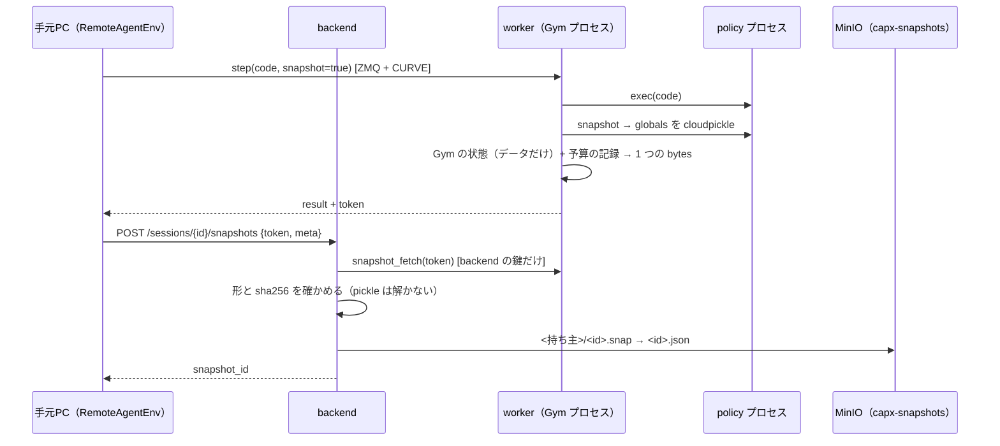

# Snapshot / Resume / Fork

過去の trial の任意の Agent Step（`env.step()` が終わった時点）から、シミュレータと
生成コードの変数・関数を元どおりに戻し、そこから別のコードを実行して分岐できる。

- 失敗する直前の状態からコードを直して実行し直す（Human Intervention）
- 同じ状態から複数のコードを実行して比べる（Best-of-N、成功・失敗の対で DPO のデータ）
- 人が直したコードや成功したコードを集める（SFT のデータ）
- 過去の Multi-turn の会話の途中から続ける

1. [参加者向け: 使い方](#1-参加者向け-使い方)
2. [仕組み](#2-仕組み)
3. [制約と対応していないこと](#3-制約と対応していないこと)
4. [管理者向け: セットアップ](#4-管理者向け-セットアップ)
5. [実測](#5-実測)
6. [テスト](#6-テスト)

---

## 1. 参加者向け: 使い方

### 1.1 Snapshot を有効にする

既定は off。`remote/.env` に 1 行足すと、`trial.py` / `suite.py` も含めて有効になる。

```dotenv
CAPX_SNAPSHOT_ENABLED=true
```

自分のスクリプトでは引数でも指定できる（引数が環境変数より優先）。

```python
from capx.remote_env.client import RemoteAgentEnv

env = RemoteAgentEnv(server_url=SERVER_URL, task_id="libero_object_3", snapshot_enabled=True)
task = env.reset_for_trial(trial=1)
print(env.initial_snapshot_id)      # reset 直後の Snapshot

result1 = env.step(code1)
print(result1.snapshot_id)          # Step 1 が終わった時点の Snapshot
result2 = env.step(code2)
print(result2.snapshot_id)          # Step 2 が終わった時点の Snapshot
```

- reset の直後と、毎 `step()` の後に、自動で保存する。Agent が何かを呼ぶ必要はない
- 生成コードが例外で終わった Step でも、その時点の Snapshot は取れる
- 保存に失敗しても trial は止めない。`result.snapshot_id` が `None` になり、理由は
  `env.last_snapshot_error` と画面（`[snapshot] 保存できなかった…`）に出る
- 保存にかかる時間は 1 Step あたり数十 ms（[実測](#5-実測)）

### 1.2 Snapshot ID を確かめる

どれでも同じ ID が見える。

| 場所 | 見るところ |
| --- | --- |
| Langfuse | trace の metadata `initial_snapshot_id`、各 `env.step` の metadata `snapshot_before` / `snapshot_after` / `agent_step` |
| 手元の結果 | `result.json` の `snapshots`（`initial` / `steps`）、`steps/step_NN.log` の `snapshot_id:` |
| スクリプト | `env.initial_snapshot_id` / `result.snapshot_id` / `env.last_snapshot_id` |
| backend | `GET /snapshots`（自分の Snapshot の一覧。新しい順） |

`env.step` の `snapshot_after` が「その Step が終わった時点」の ID。Step 2 の後から分岐したいなら、
Step 2 の `env.step` の `snapshot_after` を使う。

### 1.3 Snapshot から再開する（Resume）

```python
env = RemoteAgentEnv(
    server_url=SERVER_URL,
    task_id="libero_object_3",       # Snapshot を取ったときと同じタスク
    resume_from="snap_0123abcd...",
)
# reset_for_trial() は呼ばない。env.task に TaskSpec が入っている
result = env.step("print(helper())")  # Step 1 で定義した関数・変数がそのまま使える
```

- backend が**新しい worker** を起こし、Gym（物理・コントローラ・観測・乱数など）と、生成コードの
  変数・関数・クラスを戻してから返す。元の worker は使わない（終わっていてもよい）
- `env.step()` / `env.render()` / `env.evaluate()` は通常どおり使える。変数は以降の Step にも引き継がれる
- 残りの Step 数と実行時間の予算も Snapshot の時点のものが戻る（`env.agent_step` は通算の Step 数）
- `env.history` に、再開前の Step（コード・stdout・stderr）が入る
- 再開できなければ（無い・他人のもの・壊れている・タスクが違う・復元に失敗）、
  `capx.remote_env.client.SnapshotError` が出る。中途半端な状態の env は作られない

### 1.4 同じ Snapshot から何本も分岐する（Fork）

```python
env_a = RemoteAgentEnv(server_url=SERVER_URL, task_id=TASK, resume_from=SNAPSHOT_ID)
env_b = RemoteAgentEnv(server_url=SERVER_URL, task_id=TASK, resume_from=SNAPSHOT_ID)
result_a = env_a.step(code_a)
result_b = env_b.step(code_b)
```

- 2 つは同じ状態から始まり、その後は互いに影響しない（worker が別）
- 元の Snapshot は変わらない（何度でも同じ状態から始められる）
- 分岐した先でも `snapshot_enabled=True` にしておけば、そこからさらに分岐できる

### 1.5 サンプル（`remote/examples/`）

コピーして書き換えて使う。どれも `cd remote` してから `uv run --env-file .env ...` で動かす。

| ファイル | やること |
| --- | --- |
| `examples/resume_simple.py` | Snapshot ID から再開して、コードを 1 つ実行する |
| `examples/fork_compare.py` | 同じ Snapshot から、元のコードと直したコード（何本でも）を別々の worker で実行し、成功・reward を並べる |
| `examples/resume_multiturn.py` | Langfuse の会話の履歴を取り出し、Multi-turn の Agent をその Step の続きから走らせる（人が直したコードを 1 つ挟むこともできる） |

```bash
uv run --env-file .env examples/fork_compare.py --snapshot snap_... --task libero_object_3 \
    --original step3_original.py --fixed step3_fixed.py step3_fixed_v2.py
```

共通の道具は `remote/forking.py`。

- `open_fork(snapshot_id, task)` … 再開した env を作る
- `run_fork(env, agent, fork_type=...)` … 通常の trial と同じ Bench で回し、結果（コード・動画・
  `result.json`）を `remote/outputs/<モデル>/<タスク>__fork_<ID>/<日時>/` に保存し、Langfuse に
  新しい Trace として送る
- `RunCode([code, ...], then=agent)` … 決まったコードを実行してから、Agent に続きを任せる
- `load_conversation(trace_id, observation_id)` … Langfuse から、その Step までの LLM との会話を取り出す
  （Langfuse v4 の events_only モードでも使える observations の API を使う）

### 1.6 Langfuse での見え方

- 元の trial: いつもどおりの Trace。各 `env.step` の metadata に Snapshot ID が付く
- Fork: **新しい Trace**（tags: `fork`, `fork:<種類>`）。trace の input と metadata に次が入る

```json
{
  "parent_trace_id": "...",          // 元の Trace
  "parent_observation_id": "...",    // 元の env.step（その Step の Snapshot を保存したもの）
  "fork_snapshot_id": "snap_...",
  "fork_type": "human_edit",
  "resume_from": "snap_...",
  "agent_step": 2
}
```

元の Trace と observation の id は、Snapshot を保存したときに一緒に記録してある（Langfuse に
問い合わせなくても分かる）。Fork の中の code・stdout/stderr・LLM の呼び出し・score・動画は、
通常の trial と同じように記録される（`run_fork` を使った場合）。

### 1.7 Multi-turn の Agent を再開する

会話の履歴は Snapshot に入れていない。OpenAI SDK の記録として Langfuse に残っているものを使う
（`load_conversation`）。画像は Langfuse の参照に置き換わっているので外し、再開した状態で
撮り直した 1 枚を渡す（同梱の `multiturn_agent.py` も、最新の 1 枚だけを LLM に渡す）。

**会話以外の Agent の状態**（方針・カウンタ・メモなど）は Langfuse からは戻らない。必要なら、
Agent が `env.set_agent_state(dict)` で Snapshot に添える（JSON にできるもの、64KB まで）。
再開した側では `env.resume_info["meta"]["agent_state"]` で受け取れる。

```python
class Agent(BaseAgent):
    def run(self, env, task, budget):
        ...
        env.set_agent_state({"plan": self.plan, "retries": self.retries})  # 次の Snapshot に添わる
        result = env.step(code)
```

自分の Agent を再開できるようにするには、`examples/resume_multiturn.py` の `ContinueMultiTurn` の
ように「会話（と agent_state）を受け取って、途中から続ける」入口を作る。

### 1.8 生成コードの変数の決まり

保存できるもの: 数値・文字列・list / dict / tuple・NumPy 配列・関数（クロージャ、lambda を含む）・
クラスとインスタンス・import したモジュール・変数どうしの参照（同じオブジェクトを指す関係も戻る）。
API の関数（`goto_pose` など）を呼ぶ自作の関数も、そのまま使える。

保存できないもの: ジェネレータ・ソケット・開いたファイル・スレッド・ロックなど。こういう変数が
あると、その Step の Snapshot は**作られない**（黙って外さない）。理由は `env.last_snapshot_error` に
出る。

```
生成コードの変数を Snapshot に保存できない。保存できない変数:
  - gen（generator）: TypeError: cannot pickle 'generator' object
要らなければ `del 変数名` で消すか、`SNAPSHOT_EXCLUDE = {'変数名'}` で明示的に除外する。
```

`SNAPSHOT_EXCLUDE = {"gen"}` と書くと、その変数を外して保存する（外した名前は記録に残り、再開後は無い）。

`obs` と `INPUTS` は保存しない（Gym が渡し直す）。再開後の `INPUTS` は、**再開した時点**の観測になる。

---

## 2. 仕組み



再開は逆向き。クライアントが `POST /sessions {task_id, resume_from}` を送ると、backend は
保存先から読み、確かめてから、`--resume` 付きで新しい worker を起こし、`restore` で bytes を渡す。
`--resume` の worker は、復元が成功するまで step などを受け付けない。成功したら、クライアントに
接続先と再開の情報（TaskSpec・Step 数・履歴・保存時の meta）を返す。失敗したら worker を片付けて
エラーを返す。

### 2.1 責務

| | やること |
| --- | --- |
| クライアント | on/off、Snapshot ID の受け取り、保存の依頼、再開の依頼 |
| backend | 権限の確認、worker からの取り出し、形と sha256 の確認、保存先への読み書き、再開する worker の起動 |
| worker | Gym と生成コードの状態の保存・復元 |
| MinIO | bytes の永続化（Langfuse と同じ MinIO、別の bucket） |
| Langfuse | Trace と Snapshot ID の対応、Fork の Trace（再開そのものには使わない） |

Snapshot の bytes はクライアントを通らない。クライアントが作った bytes を worker に戻させる口も無い。

### 2.2 何を保存するか

1 つの Snapshot（`capx/snapshot/blob.py`）は 3 つの部分からなる。どれかが作れなければ、Snapshot 自体を
作らない（Gym だけ・変数だけの Snapshot は生まれない）。

| 部分 | 中身 | 形式 |
| --- | --- | --- |
| gym | Gym の状態と、予算・採点の記録 | msgpack（データだけ） |
| namespace | 生成コードの globals | cloudpickle（policy プロセスの中でだけ解く） |
| history | それまでの Step のコード・stdout・stderr | msgpack |

manifest（タスク・trial・seed・Step 数・モデルの指紋・版）と各部分の sha256 を外枠に持ち、
どの 1 バイトが壊れても読まない。zlib で圧縮する。

**Gym の状態**（`capx/snapshot/gym_state.py`）。MuJoCo の物理状態だけでは足りない。

| 種類 | 中身 |
| --- | --- |
| MuJoCo | time / qpos / qvel / act / qacc_warmstart / ctrl / qfrc_applied / xfrc_applied / mocap / userdata / eq_active。reset で書き換わるモデルの値（body_pos / body_quat / geom_rgba / site_rgba） |
| コントローラ | 目標関節角（goal_qpos）・補間器・参照姿勢など、ロボット・コントローラ・グリッパ・バッファが持つデータ全部。PandaGripper の `current_action`（前の値に足していく指令値）を含む |
| 環境 | timestep / cur_time / done、観測の cache（`_obs_cache`）、Observable の時計と最後に観測した値、乱数（env.rng、numpy / random のグローバル） |
| capx のラッパ | 目標関節角・グリッパの開き・シミュレーションのステップ数、LIBERO の最後の報酬・done・info |
| API 層 | IK の warm start（`cfg`）など、API が持つデータ |
| タスク固有 | spill_wipe の拭いた印（オブジェクトの list を名前で） |
| 予算・採点 | 済んだ Step 数・使った実行時間・最後の reward / task_completed |

カメラの画像・深度・点群は保存しない。復元した物理状態から、**物理を進めずに**描き直す
（`_update_observables(force=True)`）。LIBERO のラッパが持つ最後の観測（画像を含む）も同じく作り直す。

**reset の乱数。** robosuite と LIBERO は reset のたびにモデル（XML）を作り直し、物体の大きさや
固定物の位置を乱数で決める（cube_lift のキューブの大きさなど）。trial の reset の直前の乱数の状態を
記録しておき、復元するときは同じ乱数で reset して同じモデルを作ってから、状態を上書きする。
モデルの構造（名前と次元）とパラメータ（大きさ・質量・摩擦・位置など）の指紋を比べ、違えば
復元しない（黙って違う物理で続けない）。

**配列の共有。** robosuite のコントローラは、reset 直後は `joint_pos` / `initial_joint` / `goal_qpos` が
同じ配列を指し、目標を更新すると別れる。保存した時点の共有の形を記録し、復元先で作り直す。

**生成コードの変数**（`capx/snapshot/namespace.py`）。cloudpickle で globals を保存する。

- `exec` で作った関数とクラスは `__module__ == "__main__"` なので、中身（コード）ごと保存される
- 復元した関数の `__globals__` は、復元先の**生きた Namespace そのもの**に結び直す。次の Step で
  変数を書き換えると、関数からもその値が見える（cloudpickle のままだと、関数ごとの別の dict になる）
- API の関数（RPC のスタブ）は保存しない。印を付けておき、復元時に新しい policy プロセスのスタブに
  差し替える（古いソケットを持ち込まない）。ユーザーの関数が API を呼んでいても、list に入れていても同じ
- policy プロセスの `random` / `numpy.random` の状態も保存する（再開後に乱数の続きが同じになる）

### 2.3 保存のタイミングと整合性

- reset の直後と、各 `step()` の後。worker は Step の処理が終わってから、次の要求を受ける前に保存する
  （Gym と変数は同じ Step の境界）
- Snapshot を取っても状態は変わらない（物理を進めない・観測も取り直さない）。Snapshot の on / off で
  結果が変わらないことをテストで確かめている
- ID は、保存先に本体と記録の両方を置き終わってから返す。記録（`.json`）が後で、記録の無い Snapshot は
  存在しないものとして扱う
- Snapshot は変更しない（ID は毎回新しく作り、上書きしない）

### 2.4 安全性

- **pickle を解く場所は policy プロセスだけ。** policy プロセスはもともと生成コード（任意のコード）を
  動かす隔離された場所なので、ここで解いても危険は増えない。Gym のプロセスと backend は pickle を
  解かない（Gym の状態はデータだけの msgpack）
- **Snapshot の取り出しと復元は backend だけができる。** worker は、backend の公開鍵（CURVE）で繋いだ
  接続にだけ `snapshot_fetch` / `restore` を許す。クライアントは Snapshot の中身（採点の記録を含む）を
  読めず、自分で作った bytes を戻させることもできない
- **持ち主ごとに分ける。** 保存先の場所は `<持ち主>/<id>` で、読むときは要求した人の名前で組み立てる。
  他人の Snapshot は ID を知っていても見つからない（404）。**backend の認証（`CAPX_ENV_SERVER_TOKENS`）を
  有効にしたときだけ効く**（[制約](#3-制約と対応していないこと)）
- worker のネットワーク・権限は変えていない（`--internal`、読み取り専用、非 root、`--cap-drop ALL`、
  資源の上限）。worker に MinIO の鍵は渡さない（MinIO と話すのは backend だけ）
- 大きさの上限は 1 つ 64MB（backend の `--snapshot-max-mb`。worker にも同じ値を渡す）

---

## 3. 制約と対応していないこと

- **認証なしの backend では、持ち主の区別が無い。** 全員が `dev` になり、ID を知っている人は誰の
  Snapshot からでも再開できる（ID は 96 bit の乱数だが、Langfuse を共有していれば見える）。
  参加者の間で分けたいときは `CAPX_ENV_SERVER_TOKENS` を設定する（[4.4](#44-認証を有効にする)）
- **保存できない変数**（ジェネレータ・ソケット・ファイル・スレッド・ロックなど）があると、その Step の
  Snapshot は作られない。`del` するか `SNAPSHOT_EXCLUDE` で明示的に外す
- `obs` / `INPUTS` は保存しない。再開後の `INPUTS` は再開した時点の観測
- 生成コードの変数のうち、policy プロセスの外の状態（import したモジュールの中に書き込んだ値、
  `sys.modules` の書き換え、環境変数など）は戻らない。`random` / `numpy.random` のグローバルの乱数は戻る
- **動画は、再開した時点から録り直す。** 再開前の動画は元の Trace と手元の結果にある
- trial 全体の時間（`trial_wall_clock_s`）は再開した時点から測り直す。Step 数と実行時間は戻る
- 同じコードでやり直したときに結果が一致するのは、シミュレータと API 層が決定的な範囲。知覚 API
  （SAM3 / GraspNet / Molmo）は外部のサーバで、同じ入力でも結果が揺れることがある
- 再開は同じタスク（`task_id`）・同じ worker image の版で行う。シミュレータのモデル、または生成コードの
  変数を戻すのに使う Python / cloudpickle の版が違えば、復元できずにエラーになる（黙って続けない）。
  image を作り直したら、それより前の Snapshot は使えないことがある
- 対応するのは robosuite（cube_stack / cube_lifting / cube_restack / nut_assembly / spill_wipe /
  two_arm_lift）と LIBERO（LIBERO-PRO の標準 5 suite）。BEHAVIOR・実機・ローカル実行
  （`local/trial.py`。生成コードを同じプロセスで動かす）は対応していない
- 保存した Snapshot は自動では消えない。消すのは `DELETE /snapshots/{id}`（本人）か、管理者が
  MinIO の lifecycle で古いものを消す

---

## 4. 管理者向け: セットアップ

変更が要るのは backend（GPU マシンで動くプロセス）と worker の image。手元 PC 側は
`git pull` だけでよい（依存は増えていない）。

### 4.1 MinIO に bucket と鍵を作る

Langfuse が使っている MinIO を共用する。bucket は Langfuse とは分ける。

```bash
mc alias set capx http://<MinIO の IP>:9000 <管理者のキー> <管理者のシークレット>
mc mb capx/capx-snapshots
cat > capx-snapshots-policy.json <<'EOF'
{
  "Version": "2012-10-17",
  "Statement": [
    {"Effect": "Allow", "Action": ["s3:GetBucketLocation", "s3:ListBucket"],
     "Resource": ["arn:aws:s3:::capx-snapshots"]},
    {"Effect": "Allow", "Action": ["s3:GetObject", "s3:PutObject", "s3:DeleteObject"],
     "Resource": ["arn:aws:s3:::capx-snapshots/*"]}
  ]
}
EOF
mc admin policy create capx capx-snapshots capx-snapshots-policy.json
mc admin user add capx capx-backend <シークレット>
mc admin policy attach capx capx-snapshots --user capx-backend
# 任意: 30 日より古い Snapshot を消す
mc ilm rule add --expire-days 30 capx/capx-snapshots
```

### 4.2 backend の環境変数

backend を起動するシェル（または systemd の EnvironmentFile）に置く。

```dotenv
CAPX_SNAPSHOT_S3_ENDPOINT=http://192.168.x.x:9000
CAPX_SNAPSHOT_S3_BUCKET=capx-snapshots
CAPX_SNAPSHOT_S3_ACCESS_KEY_ID=capx-backend
CAPX_SNAPSHOT_S3_SECRET_ACCESS_KEY=<シークレット>
# 任意
CAPX_SNAPSHOT_S3_REGION=us-east-1
CAPX_SNAPSHOT_S3_PREFIX=v1/
```

backend は Langfuse の API にはアクセスしない。S3 との通信は `requests` で行い（SigV4 で署名）、
boto3 などの追加の依存は要らない。

届くかどうかは、backend と同じ環境で確かめられる。

```bash
uv run --no-sync --active scripts/snapshot_s3_check.py
# OK bucket に届く / OK 置ける / OK 読める / OK 一覧にできる / OK 消せる
```

### 4.3 worker の image を作り直し、backend を再起動する

worker の image に Snapshot のコード（`capx/snapshot/`、worker と policy プロセスの変更）が入る。

```bash
git pull
docker build -f docker/worker/Dockerfile -t capx-worker:latest .
docker build -f docker/worker/Dockerfile.libero -t capx-worker-libero:latest .
# backend を再起動（起動時に保存先へ届くかを確かめ、ログに「Snapshot の保存先: s3:...」と出る）
uv run --no-sync --active -m capx.remote_env.server
```

保存先の設定が無い backend は、Snapshot を使わない通常の trial をそのまま受け付ける（クライアントが
Snapshot を有効にしていると、保存は 503 で失敗し、trial は続く）。`GET /health` の `snapshots` で
有効かどうかが分かる。

### 4.4 認証を有効にする

参加者ごとに Snapshot を分けるには、backend の認証を有効にする（[2.4](#24-安全性)）。

```dotenv
# backend
CAPX_ENV_SERVER_TOKENS=alice:<トークンA>,bob:<トークンB>,...
# 各参加者の remote/.env
CAPX_ENV_SERVER_TOKEN=<その人のトークン>
```

### 4.5 API

| | |
| --- | --- |
| `POST /sessions` `{task_id, client_public_key, resume_from?}` | `resume_from` を渡すと、その Snapshot を戻した新しい worker（応答に `resume`） |
| `POST /sessions/{id}/snapshots` `{token, meta}` | worker が作った Snapshot を保存して ID を返す（クライアントが Step ごとに呼ぶ） |
| `GET /snapshots?limit=50` | 自分の Snapshot の記録の一覧（新しい順） |
| `GET /snapshots/{id}` | 自分の Snapshot の記録（タスク・Step 数・大きさ・Trace・版） |
| `DELETE /snapshots/{id}` | 自分の Snapshot を消す |

本体（bytes）を返す口は無い。

### 4.6 容量と負荷の目安

1 つの Snapshot は数十 KB（生成コードの変数に画像や点群を持つと、その分増える）。1 trial（10 Step）で
11 個、20 人が 1 日 100 trial ずつ回すと 20 × 100 × 11 × 20KB ≒ 0.5GB/日。Step ごとの保存は、
worker → backend → MinIO の 1 往復（数十 ms）で、Step の時間（数秒〜数十秒）に比べて小さい。
worker は backend が取り出すまで Snapshot を最大 2 つ持つ（ふつうは 1 つ、数十 KB）。

---

## 5. 実測

### 5.1 手元（macOS / Apple Silicon、CPU、backend と worker は同じマシンの別プロセス、保存先はディレクトリ）

`scripts/snapshot_bench.py --local`。API は知覚・IK のサーバに頼らないテスト用のもの（関節角を直接動かす）。

| 項目 | robosuite（cube_stack） | LIBERO（libero_object_0） |
| --- | --- | --- |
| Gym（圧縮前 → 後） | 38.3KB → 12.7KB | 43.3KB → 16.0KB |
| 生成コードの変数（関数 1 つ + list） | 0.6KB → 0.5KB | 0.6KB → 0.5KB |
| Snapshot 全体 | 14.5KB | 17.7KB |
| worker で作る | 5ms | 6ms |
| backend が取り出す | 4ms | 4ms |
| 保存先に置く | 1ms | 1ms |
| クライアントが待つ保存全体 | 8ms | 7ms |
| Step（OFF / ON、保存を含む） | 0.20s / 0.21s | 0.41s / 0.41s |
| セッション作成（通常） | 5.3s | 5.7s |
| 再開（Fork 作成。worker の起動 + 復元） | 4.7s | 6.2s |
| うち復元だけ | 0.61s | 1.08s |
| 変数に点群（12000×3 float64）を足す | +282KB（圧縮後 +266KB） | 同左 |
| 変数に画像（512×800×3 uint8、乱数）を足す | +1.2MB（ほぼ圧縮されない） | 同左 |

- 再開の時間の大半は、新しい worker で環境を作る時間（通常のセッション作成と同じ）。復元そのものは
  reset（モデルの作り直し）+ 状態の上書きで 1 秒前後
- 画像や点群は Gym の Snapshot には入れない（描き直す）。生成コードの変数に持っている分だけ増える
- 圧縮は zlib（level 6）。物理状態は 1/3 程度になる。乱数の画像はほとんど縮まない

### 5.2 GPU マシン（実際の backend・Docker の worker・MinIO、手元 PC から VPN 越し）

2026-10-23 に計測した。`scripts/snapshot_bench.py --task cube_stack_low` / `--task libero_object_0_low`。
Low-Level 版のタスクを使い、関節角を直接動かす関数だけで動かしている（知覚サーバは使わない）。

| 項目 | robosuite（cube_stack_low） | LIBERO（libero_object_0_low） |
| --- | --- | --- |
| Gym（圧縮前 → 後） | 38.4KB → 12.7KB | 43.3KB → 15.8KB |
| 生成コードの変数（関数 1 つ + list + 乱数の状態） | 7.0KB → 6.3KB | 7.0KB → 6.4KB |
| Snapshot 全体 | 20.4KB | 23.5KB |
| worker で作る | 7ms | 8ms |
| backend が取り出す | 6ms | 6ms |
| MinIO に置く | 28ms | 29ms |
| クライアントが待つ保存全体 | 45ms | 46ms |
| Step（OFF / ON、保存を含む） | 0.20s / 0.25s | 0.40s / 0.45s |
| セッション作成（通常） | 11.3s | 16.1s |
| 再開（Fork 作成。worker の起動 + 復元） | 12.9s | 18.1s |
| うち復元だけ | 1.47s | 2.08s |
| 変数に点群（12000×3 float64）を足す | +281KB（圧縮後 +265KB） | 同左 |
| 変数に画像（512×800×3 uint8、乱数）を足す | +1.2MB（ほぼ圧縮されない） | 同左 |

- Snapshot の ON で、1 Step あたり約 50ms 増える（大半は MinIO への書き込み）。LLM を使う
  trial の Step（数秒〜数十秒）に比べて小さい
- 再開は通常のセッション作成 + 1.5〜2 秒

**受け入れのシナリオ**（`scripts/snapshot_e2e_check.py`）は、両方のタスクで 12 / 12 が通った。
Step 1 の関数を別の worker で使う、元の Step 3 を別の worker でやり直すと関節角と reward が元と
一致する、Fork からの再分岐、元の Snapshot が変わらない、無い Snapshot を断る、の各項目。

実際の LLM（Qwen 3.5 9B）で `libero_object_0` を Snapshot ON で 10 Step 回し、10 Step すべての
Snapshot が保存され、Langfuse の各 `env.step` に Snapshot ID が載ることを確かめた。その Step 1 の
Snapshot から `examples/resume_multiturn.py` で会話ごと再開し、Fork の Trace の `parent_trace_id` /
`parent_observation_id` が元の Trace と env.step を指すことも確かめた。

---

## 6. テスト

| ファイル | 見ていること | 要るもの |
| --- | --- | --- |
| `tests/test_snapshot_namespace.py` | 変数・関数・クロージャ・クラス・NumPy・API を呼ぶ関数・スタブの差し替え・globals の結び直し・乱数・保存できない変数の検出・明示的な除外・大きすぎるとき | なし |
| `tests/test_snapshot_store.py` | 形式（1 バイトの破損・不完全・版違いを読まない）、保存先（持ち主ごと・上書きしない・壊れた本体・記録の無いもの） | なし |
| `tests/test_snapshot_s3.py` | S3 の署名が botocore と一致、S3 サーバとの往復、一覧の継続 | botocore / moto |
| `tests/test_snapshot_worker.py` | 取り出し・復元は backend の鍵だけ、`--resume` の worker は復元まで使えない、Snapshot の失敗で Step を失敗にしない、古いクライアントとの互換 | なし |
| `tests/test_snapshot_server.py` | 保存し終わってから ID を返す、再開は新しい worker で・失敗したら片付ける、他人の Snapshot に触れない（HTTP を含む） | fastapi（HTTP の部分） |
| `tests/test_snapshot_client.py` | on/off の決まり（引数 > 環境変数 > off）、各 Step の ID、保存に失敗しても続く、再開に reset が要らない | なし |
| `tests/test_remote_tracing.py` | env.step の Snapshot ID、初期 Snapshot、Fork の Trace と元の Trace のつながり、会話の取り出し | langfuse |
| `tests/test_snapshot_gym.py` | 内部状態がそのまま戻る、同じコードで同じ結果（ビット単位）、物理だけでは足りない、物理を進めずに観測を作り直す、Snapshot の on/off で結果が変わらない、モデルが違えば断る | robosuite か LIBERO |
| `tests/test_snapshot_e2e.py` | 受け入れのシナリオ全体（Step 1 の関数を別の worker で使う、元の Step 3 を別の worker でやり直すと元と一致、Fork からの再分岐、backend の再起動、他人・壊れた・不完全な Snapshot、S3 経由）、サンプルの道具 | robosuite か LIBERO、fastapi、uvicorn |

`test_snapshot_gym.py` と `test_snapshot_e2e.py` はシミュレータが要る。GPU マシンの worker image の
環境か、robosuite / LIBERO を入れた環境で動かす。E2E は Docker を使わず、backend・worker・保存先を
手元のプロセスとして動かす（`tests/snapshot_harness.py`）。
